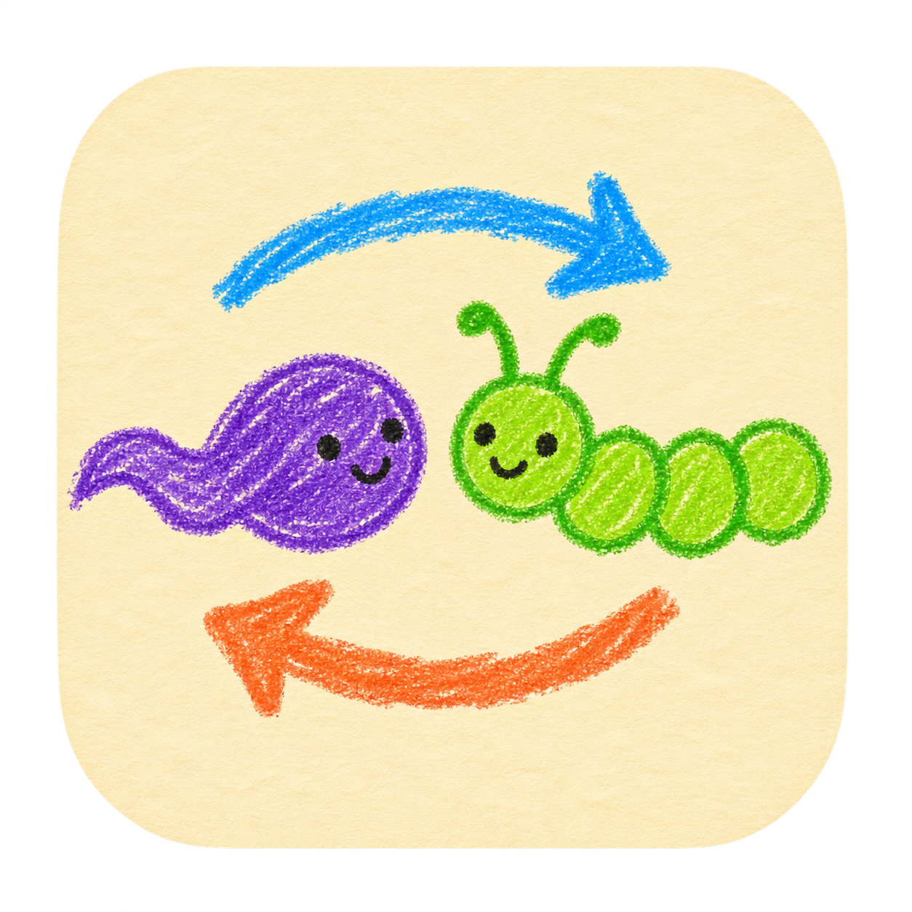

# 点读包转换

一个在 Mac 上离线转换 **🐛 BNL** 和 **小时候的🐸 BNF** 点读包的工具。把点读包从 Finder 拖进 App，选个保存位置，就能生成另一种格式的音频版点读包。

**当前支持经过验证的 BNF v11 和 BNL 模式 2 样本。** 两个方向都完成了桌面转换与文件回读验证。生成的文件能否在目标笔上直接点原书，仍待实机确认。

## 快速开始

需要 **macOS 14 或更新版本**。App 是通用二进制，适用于 Apple 芯片（arm64）和 64 位 Intel（x86_64）Mac。从 [Releases](https://github.com/Thregren/reading-pen-converter/releases/latest) 下载 macOS ZIP，解压后打开「点读包转换.app」。当前构建使用本地临时签名，尚未经过 Apple 公证。

1. 从 Finder 拖入一个 `.bnf` 或 `.bnl` 文件，也可以点击“选择点读包”。
2. App 自动识别格式和转换方向，使用内置的模板与固件数据，弹出保存窗口。
3. 选一个 Mac 本地的保存位置。完成后点击“在 Finder 中查看”，即可找到新点读包和同目录的 `.conversion.json` 报告。



转换在 Mac 上完成，原始文件保持原样。App 会检查输出目录里同格式包的注册范围，发现冲突时会提示。笔内已有包、其他目录和设备缓存需要另行核对。

## 转换会保留什么？

App 从源包读取数值点读码、播放列表和 MP3 音频，按原数值点读码重建目标格式的索引和音频，然后回读新包核对对应关系。

- **保留**有效音频点的原数值点读码及对应音频。当前使用固定的目标模板，输出新包会继承模板的部分身份字段。
- **简化**已识别的系统控制和部分非音频事件。BNF 转 BNL 时，轮换或随机播放会变成固定列表。转换报告会记录相关变化，遇到超出支持范围的命令，转换会报错。
- **实机待测**。同一纸面位置必须在目标笔上产生可命中新包的编号，才能播出对应音频。目前还没有两支笔点同一位置的读数，App 按原码写出。

| 样本 | 方向 | 文件级验证 |
| --- | --- | --- |
| 《GoGo 默认卡－儿歌》 | BNF → BNL | 原有的 1 个有效音频码保持一致 |
| 《Who Did That》 | BNL → BNF | 原有的 99 个有效音频码逐个一致 |

## 从源码构建

需要 Swift 6 工具链和 Python 3。从源码打包时，请按 `scripts/build.sh` 中的路径准备本地 v103 固件和两个模板样本。样本依赖的测试也需要对应的本地数据。已打包的 App 自带转换资源和 MP3 校验器。

```sh
./scripts/build.sh
swift test
```

构建脚本会为两种架构编译并合并 App 和命令行工具。构建后，可从 `dist/` 打开 App 或运行命令行工具。直接运行 `./dist/penconvert` 可查看命令列表，其中包括包检查、目录扫描、音频提取和 BNL 重封包。

| 路径 | 用途 |
| --- | --- |
| [Sources/PenMac](Sources/PenMac) | SwiftUI 界面、Finder 拖放与保存流程 |
| [Sources/PenCore](Sources/PenCore) | 格式解析、转换、回读校验和码段冲突检查 |
| [Sources/PenCLI](Sources/PenCLI) | 命令行入口 |
| [Tests/PenCoreTests](Tests/PenCoreTests) | 解析、写出和冲突检查测试 |
